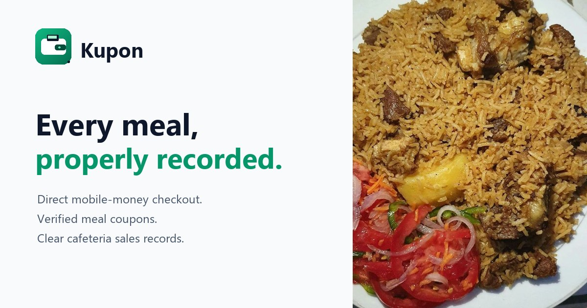

# Kupon.

**Trusted cafeteria orders, coupons and sales records for Tanzanian universities.**

Kupon replaces unreliable notebooks with QR-based menu ordering, traceable coupons and searchable transaction records. Checkout currently uses Kupon's own test gateway: it automatically records simulated payment receipt and confirmation, but does not collect or hold real money. Students have no Kupon wallet; test cafeteria credit is limited to the cafeteria that issued it.

Built with Next.js 14 App Router, TypeScript, Tailwind CSS, shadcn/ui patterns, Prisma + PostgreSQL, Recharts, `qrcode.react` and `html5-qrcode`.



---

## Preview

Captured from the running app with real seeded data at 375px and desktop widths
(`pnpm screenshots` regenerates the whole set).

<table>
  <tr>
    <td width="50%"></td>
    <td width="50%"></td>
  </tr>
  <tr>
    <td></td>
    <td></td>
  </tr>
  <tr>
    <td></td>
    <td></td>
  </tr>
  <tr>
    <td></td>
    <td></td>
  </tr>
</table>


<table>
  <tr>
    <td width="50%"></td>
    <td width="50%"></td>
  </tr>
</table>

---

## Why Kupon

| Problem today | Kupon's intended fix |
| --- | --- |
| Paper records fill up, disappear or are difficult to search | Append-only transaction and coupon records with audit history |
| A change of notebook or staff makes a customer's claim hard to verify | A consistent record for every order and credit decision; the problem is record reliability, not assumed dishonesty |
| Students may need to find cash or leave money with the cafeteria | Direct mobile-money checkout is the planned live flow; this test gateway records payment states without moving real money or creating a student wallet |
| Cafeterias lack dependable sales visibility | Database-backed transaction and menu analytics for transparency and decisions |
| The system must grow beyond one cafeteria | Start with one cafeteria, support seven outlets, then expand to cafeterias at other universities through vendor-scoped data and role boundaries |

---

## Feature tour

### Student (mobile-first, installable PWA)

- **Google sign-in** for students. Vendor owners and staff use their own sign-in pages and can choose a password or Google; there is no student wallet or top-up flow.
- **Scan the cafeteria counter QR**, browse today's available menu, and see the food total plus a 2.5% test collection fee before ordering. Kupon's internal gateway records `INITIATED → RECEIVED → CONFIRMED` automatically; Finance is not part of checkout.
- Cafeteria owners can auto-accept every order or review requests. A **meal coupon** with items, order ID, fallback code and QR appears only after payment confirmation and any required cafeteria acceptance.
- Transaction history with Today / Week / Month tabs, type/status filters and totals.
- Credit request for an unfulfilled order; the cafeteria can reject it or forward it to a platform admin. Approved credit is restricted to that cafeteria and visible to the student. A further-review ticket records a TZS 1,500 test-only cafeteria charge; no cash refund occurs.
- Approved cafeteria credits are shown to students with their cafeteria name and current available amount.
- Profile, university, student ID, PWA install hint and logout.

### Vendor (mobile-first POS)

- New owners submit a cafeteria application before signing in. The platform admin reviews the business, campus, and site; after approval, the owner verifies with Google and sets a password. Existing owners can use either Google or phone/password.
- A printable, camera-friendly **counter QR** (`KPN:V:<vendor code>`) for students to scan. It opens the vendor's live approved menu and cannot move money on its own.
- **Order desk:** confirmed test requests, grouped by food and quantity, with individual or bulk acceptance. Auto-accepted items skip manual review; coupons stay hidden until accepted. Staff can report unavailable food for platform-admin review.
- **Coupon verification:** scan the student's coupon QR or enter the 6-digit code shown on their phone. Single-use conditional status transition plus a celebratory verified screen; the student coupon updates live.
- Menu management with a live student preview, photos, prices, categories, availability and per-food auto-accept. Vendors upload their own dish photos; there is no emoji fallback. Food is vendor-owned and goes live immediately; admins vet the cafeteria, not each dish.
- Menu availability, order history, cafeteria-scoped credit cases, payment history and test withdrawals. Withdrawals require TZS 50,000 and record a TZS 2,000 fee (TZS 1,500 API + TZS 500 Kupon); they do not send real money.
- Team access: cafeteria owners can issue scoped, one-time invitations for staff and Finance; platform admins can do the same. Invitees set a password and can also use Google with the invited email.
- Sales analytics exclude internal test payments from real-money totals.
- Vendor never sees another vendor's or university's orders or sales.

### Cafeteria staff

- The cafeteria owner invites each staff member; platform admins can also issue a scoped invitation.
- Staff sign in at `/staff/login` with their phone/password or invited Google email, see only their assigned cafeteria, verify its coupons and update daily menu availability.
- Staff cannot edit prices, view settlements, manage accounts or approve/confirm payments.

### University admin (responsive dashboard)

- Database-backed sales and vendor oversight; test-only transactions are excluded from real-money reporting.
- 7-day revenue area chart with transaction counts and net profit.
- Top-selling meals with progress bars and a horizontal bar chart.
- Live transaction feed with status badges.
- Searchable/filterable transaction table, CSV download and print-to-PDF report.
- Vendor sales oversight and support.
- Student search and audit history.
- Active-vendor oversight and scoped team-account creation. New cafeteria applications and physical-site checks are handled by platform admins; university admins cannot activate pending applications or issue cafeteria credit.
- University profile, **Lipa Namba** routing code, SaaS billing invoices, ledger health, audit trail.
- Daily/weekly/monthly profit & loss, fee waterfall, revenue leakage and top vendors.

### Super admin (Bubaa Comp)

- All tenants, revenue today, monthly GMV, platform fee revenue, SaaS MRR.
- Onboard a university: code, route code, city, SaaS fee, first admin account.
- Suspend/reactivate tenants, edit Lipa Namba with uniqueness validation and audit.
- Platform revenue: GMV, transaction fees, university share, aggregator cost, SaaS revenue, net.
- Review cafeteria credit requests after vendor escalation; approval records cafeteria-specific student credit, not a cash refund.
- System health: transaction status, ledger balance check, mock uptime/latency and service status.

### Finance

- Cafeteria-created Finance accounts are scoped to that cafeteria; platform admins may create scoped accounts or platform-wide Finance accounts.
- Inspect internal test-payment records and their automatically recorded lifecycle (read-only).
- View test-payment history and review scoped support tickets. Credit history is read-only.
- Finance cannot approve checkout or issue student credit. Test records do not represent actual collection or payout.

### USSD — paused

USSD/offline payments are **not supported in this build**. The legacy wallet-based simulator and API are disabled unconditionally. `/ussd` renders the not-found page and `/api/ussd` returns `404 USSD_DISABLED`.

---

## Tech stack

| Layer | Choice |
| --- | --- |
| Framework | Next.js **14.2.35** App Router, TypeScript, React 18 |
| UI | Tailwind CSS, shadcn/ui-style primitives (Radix UI), Lucide icons, Sonner toasts |
| Charts | Recharts |
| State | Local React state + typed fetch client; session from httpOnly JWT cookie |
| QR | `qrcode.react` (generate), `html5-qrcode` (scan) |
| Auth | `jose` HS256 JWT in an httpOnly, SameSite=Lax cookie; bcrypt for manual credentials; Google OAuth 2.0 for students, vendors and invited staff |
| Validation | Zod on every mutation + query filter |
| Database | Prisma 6 + PostgreSQL (Supabase) |
| Payments | Internal Kupon test gateway; no live provider integration or real-money custody |
| SMS | Mock SMS logger; legacy wallet-based USSD flow is disabled |
| PWA | Web manifest, maskable icons, offline fallback, service worker (never caches API/HTML) |
| Deploy | Vercel-compatible Next app; use Postgres for persistent serverless data (see below) |

---

## Quick start

Prerequisites: **Node.js 20+**, **pnpm 9+** (npm also works but lockfile is pnpm).

```bash
# 1. Install
pnpm install

# 2. Configure
cp .env.example .env        # Windows PowerShell: copy .env.example .env

# 3. Apply the PostgreSQL schema
pnpm db:migrate:deploy

# 4. Run
pnpm dev
```

Open **http://localhost:3000**.

> Configure both `DATABASE_URL` (transaction pooler) and `DIRECT_URL` (session
> pooler) in `.env` before running Prisma commands. The example URLs use a
> placeholder password; URL-encode special characters in your real password.
> `pnpm db:seed` creates destructive demo data; run it only against a disposable
> development project, never the production database. The legacy Wallet table remains for
> historical compatibility only; current student checkout and credit flows do not use it.


### just do this broo 
``` bash


pnpm dev

ngrok http 3000


```


### Verify the build

```bash
pnpm typecheck
pnpm lint
pnpm build
pnpm start
```

---

## Demo credentials

Kupon does not ship shared platform-owner credentials. Configure `SUPER_ADMIN_SETUP_TOKEN` with a random value of at least 32 characters, run the app, and open `/first-owner` to create the first platform owner with a username and password. A phone number and Google email are optional. Setup becomes unavailable after a super-admin account exists. Staff and platform admins can sign in with their username or phone number.

Generate a setup token with `node -e "console.log(require('node:crypto').randomBytes(48).toString('base64url'))"` and add it to the local `.env` and deployment environment. Do not commit the value.

Students use Google at `/login`. Cafeteria owners apply at `/vendor-apply` without choosing a preconfigured campus or signing in first. Applicants provide the owner's name, NIDA number and reliable phone, the cafeteria and institution names and contact numbers, an email for later Google sign-in, and upload a TIN/TRA document. The document is stored privately in PostgreSQL and can only be downloaded by a platform admin for review. The Kupon Platform Admin creates institutions in **Platform → University management** (`/super-admin/tenants`), then reviews the request, verifies the cafeteria and assigns it to that institution. Applicants only name the institution; they cannot create or approve it. After approval, the owner continues with Google using the email on the application and sets a password. Existing owners use `/vendor/login`. Staff use `/staff/login`; their cafeteria owner or a platform admin generates a one-time invitation at `/vendor/team` or `/admin/team`.

The demo seed is only for disposable development databases. It does not create a platform owner. Never run it against production data.

### Google auth: students, vendors and staff

Phone OTP is temporarily disabled in the UI (`OTP_LOGIN_ENABLED = false` in `app/login/login-form.tsx`). The complete OTP code and API endpoints are kept intact for when SMS delivery is enabled.

**Student — Continue with Google** handles both paths:

1. **Existing student account** — the Google email is already linked (`User.email` / `googleId`), so the callback signs the student into that account.
2. **New student** — a verified Google email with no account is redirected to `/signup/google`. The student confirms their name, mobile number, student number, course and year. Kupon creates a student profile and writes an audit entry. No SMS OTP is involved and no admin approval is needed.
3. **Existing student account with an unlinked Google account** — the callback does **not** attach the Google account automatically. An admin links it from **Students → Google sign-in fallback**, or the CLI links it.

Security model:

1. Google OAuth authorization-code flow with a random signed `state` cookie (10-minute TTL) and server-side token exchange.
2. Google's `email_verified` claim is required.
3. The OAuth callback never creates a wallet by itself. It issues a **signed, HttpOnly, 15-minute signup ticket**; the signup POST must present that ticket, so a browser cannot create accounts without Google consent.
4. The signup route re-checks university status, unique Google email/sub, unique phone and unique student number inside one transaction, then writes `User`, `StudentProfile` and the audit log atomically. No student wallet is created.
5. The same httpOnly Kupon session cookie is issued after signup or sign-in; the client secret never reaches the browser.

> Open Gmail signup is intentionally enabled for this MVP. For a production campus rollout, restrict signup to the university's Google Workspace domain (or match student numbers against the registry).

**Vendor — `/vendor-apply`, then `/vendor/login`**

1. Apply first at `/vendor-apply`. Enter the owner name, NIDA number, reliable owner phone, cafeteria name, institution name and contact phone, Google email, and upload the TIN/TRA document (PDF/JPG/PNG, up to 5 MB).
2. The platform admin creates the institution under **Platform → University management** if needed, privately downloads and reviews the document, verifies the cafeteria and assigns the application to an active Kupon campus.
3. After approval, open `/vendor/login` and continue with Google using the same email entered on the application.
4. Google verifies the email, then the owner creates a password. Kupon creates the vendor account only after this approved Google verification and signs the owner in.
5. Existing vendor owners can sign in with Google or phone/password. Pending or rejected requests cannot use operational APIs.

**Staff — `/staff/login`** accepts phone/password or Google sign-in. Google only works for an existing staff/Finance/admin record whose email matches the verified Google email. Invitations are single-use, expire after seven days, and bind the account to one cafeteria.

**First platform owner:** configure `SUPER_ADMIN_SETUP_TOKEN` in the server environment and visit `/first-owner`. The first owner chooses a username and password; the password is stored as a bcrypt hash. Staff and platform admins can sign in with a username or phone number.

Configure it in `.env` (see `.env.example`):

```env
GOOGLE_CLIENT_ID="..."
GOOGLE_CLIENT_SECRET="..."
GOOGLE_REDIRECT_URI="http://localhost:3000/api/auth/callback/google"
```

Add the exact redirect URI to **Google Cloud Console → APIs & Services → Credentials → OAuth 2.0 Web Client**. For production, set `GOOGLE_REDIRECT_URI` to the deployed URL and add that exact URI in Google Cloud Console.

Link a real Google email to an existing demo student account, either from the admin UI or the CLI:

1. **Admin UI:** sign in as university admin → **Students** → open the student → **Overview** → **Google sign-in fallback** → enter the student's Google email → **Link email**. Audit-logged.
2. **CLI:**
   ```bash
   pnpm link:google +255712345678 your.email@gmail.com
   ```

Then sign out and choose **Continue with Google**. The seed already includes university emails for every student (`amina.mwinyi@udsm.ac.tz`, `kelvin.mwakalinga@must.ac.tz`, etc.), but those are illustrative; link the student's real Google address first.

**Google OAuth troubleshooting**

- **Use `http://localhost:3000`, not `http://127.0.0.1:3000`.** The Google Cloud client is configured for localhost. The start route detects a 127.0.0.1 host and canonicalizes it, but the cleanest demo URL is localhost.
- **`ERR_CONNECTION_REFUSED` after Google:** the Kupon server was not running, or was on a different port/host when Google redirected back. Start it with `pnpm start` (or `pnpm dev`) and keep the same origin open. Check `http://localhost:3000` first.
- **`redirect_uri_mismatch`:** add exactly `http://localhost:3000/api/auth/callback/google` (and the production equivalent) under Google Cloud Console → APIs & Services → Credentials → your OAuth 2.0 Web Client → Authorised redirect URIs. Set `GOOGLE_REDIRECT_URI` to the same value.
- **`Access blocked` / app not verified:** while the OAuth consent screen is in Testing, add your Google account as a test user in Google Cloud Console, or publish the app.
- **Google auth on the hosted app:** open the stable Vercel domain from your phone. Set `GOOGLE_REDIRECT_URI` to `https://<your-domain>/api/auth/callback/google` in Vercel and add that exact URI to the OAuth client’s authorized redirect URIs in Google Cloud Console. A local tunnel is not needed for the hosted app.
- **Existing account not linked to Google:** the callback does not attach Google automatically. Link it from **Admin → Students → student → Google sign-in fallback**, or run `pnpm link:google <phone> <email>`. New students do not need this step — they get the signup form.
- **`google_signup_expired`:** the 15-minute signup ticket expired. Start **Continue with Google** again.
- **`google_vendor_not_approved`:** the Google email has no approved vendor application. Apply at `/vendor-apply` and return after platform review.
- **`google_vendor_activation_expired`:** Google verification expired during account activation. Continue with Google again.
- **Phone or student number already registered:** ask an admin to link the Google email to the existing student account. Signup never merges identities.

---

## Five-minute demo script

1. **Student:** sign in at `/login` with Google. Student accounts do not have a Kupon wallet.
2. **Order:** open the student order screen, scan/select a cafeteria, choose available meals and place an order. Kupon's test gateway records `INITIATED`, then automatically advances to `RECEIVED` and `CONFIRMED`; no money is collected.
3. **Payment activity:** a Finance user may inspect the read-only timeline at `/finance/test-payments`. Finance cannot accept, reject or confirm student payments.
4. **Coupon:** Kupon issues a QR and fallback code after automatic confirmation. The coupon disappears from active orders when it expires.
5. **Vendor:** open the vendor order desk and verify the student's coupon by QR or fallback code.
6. **Credit flow:** from an active coupon, submit an unfulfilled-order request. The cafeteria can accept it; the resulting test credit is limited to that cafeteria and can be applied to a later test order.
7. **Escalation:** the student may open a further-review ticket. The TZS 1,500 vendor charge is a test ledger entry only; Finance review does not issue a cash refund.
8. **Tenant isolation:** sign in as a different university admin. Cross-tenant records remain inaccessible.
9. **Super Admin:** manage platform-wide tenants and Finance access.


---

## Internal test-payment lifecycle

Order payments move through auditable states: `INITIATED → RECEIVED → CONFIRMED`, or
`EXPIRED`. Kupon's test gateway records these transitions automatically as the student
checkout is polled; Finance has read-only visibility and cannot approve a payment.
Confirmation issues the coupon and records test-ledger entries; it does **not** debit a
student's wallet, collect mobile money, hold real cash, settle real vendor earnings or
trigger a payout.

Unfulfilled-order credits are stored separately from any future live-credit account and are
restricted to the issuing student/cafeteria pair. Failed or expired test payments restore
reserved test credit. The TZS 1,500 escalation fee is also test-only. A production payment
rail, money custody, refunds or payouts are not implemented.

---

## Project structure

```text
app/
  page.tsx                    Marketing landing (supplied brand hero image)
  login/                      Google-first student/vendor auth + staff password (OTP code retained, disabled)
  student/                    QR ordering, test checkout, coupons, cafeteria credit, history
  vendor/                     POS home, coupon verification, sales and menu
  finance/                    Test-payment lifecycle and cafeteria support review
  admin/                      Dashboard, transactions, vendors, students, reports, settings
  super-admin/                Tenants, platform revenue, health
  ussd/                       Legacy feature-phone simulator (disabled)
  api/                        Route handlers with RBAC + Zod
    auth/ student/ vendor/ admin/ super-admin/ ussd/ universities/
components/
  ui/                         shadcn-style Button, Card, Table, Badge, Dialog, Tabs, Input, Skeleton...
  layout/                     StudentShell, VendorShell, DashboardShell, service worker
  charts/                     Recharts area, bar and volume charts
  qr/                         PaymentQR, QrScanner
lib/
  auth.ts                     JWT session, page/API guards, tenant assertion
  api.ts / errors.ts          Response envelope + typed errors
  db.ts                       Prisma singleton
  payments/                   Internal test-payment transitions and legacy compatibility
  ledger.ts / wallet.ts       Test ledger + dormant legacy wallet code
  qr.ts                       Signed 120s QR token + 6-digit fallback
  tenant.ts                   Admin tenant scoping
  validators/                 Zod schemas
  fees.ts / dates.ts / utils.ts
prisma/
  schema.prisma               Multi-tenant schema
  seed.ts                     2 universities, 10 students, 6 vendors, 40 menu items, 160+ transactions
docs/API_CONTRACTS.md         Route-by-route contract used by the team
scripts/                      Seed verification, smoke tests, screenshots
```

---

## Data architecture: database-backed UI

No marketing metric, test account, transaction, coupon, ledger line or vendor list is hardcoded in the UI.
- `lib/public-data.ts` provides live platform totals for the public landing page, including the value of verified meal orders. The landing page itself is image-free.
- The login page reads its campus snapshot from Prisma (students/vendors/dishes); there are no shared platform-owner credentials.
- The student scanner fetches active vendors from the database via `GET /api/student/vendors`; there is no `DEMO_VENDORS` array.
- Food photos are vendor-uploaded files (`POST /api/vendor/menu/upload`) and stored on `MenuItem.imageUrl`; emoji are ignored in the interface. Uploaded files are served by `GET /api/uploads/food/<filename>` because Next.js production does not serve files added to `public/` after the build. In production, point the upload route at S3/R2/Cloudinary instead.

## Authentication architecture

Kupon separates **customer auth** from **staff auth** at the route level, not just with a hidden tab:

| Audience | Entrance | Notes |
| --- | --- | --- |
| Students | `/login` (Student) | Google sign-in/signup; OTP UI disabled behind a flag |
| Vendors | `/vendor-apply`, then `/vendor/login` | Apply without sign-in; after platform approval, verify with Google and set a password |
| Cafeteria staff | `/staff/login` | Phone/password or Google matching the invited email |
| Platform operators | `/staff/login` | First owner is created at `/first-owner`; username/password login (Google sign-in requires a linked email) |

- `/login` renders only Student sign-in. Vendor owners and staff have distinct entry points linked from the landing page.
- `/login?role=staff` redirects to `/staff/login` for old bookmarks.
- `/admin` and `/super-admin` layouts redirect unauthenticated users to `/staff/login`, not `/login`.
- Staff sign-out and the dashboard sign-out button return to `/staff/login`.
- `/staff/login` is `noindex` and disallowed in `robots.ts`.
- Cafeteria owners/platform admins create one-time, seven-day staff invitations; invitees choose a password and can also use Google with that email.
- First-owner setup requires a 32+ character `SUPER_ADMIN_SETUP_TOKEN`; it closes when a super-admin account exists.

## Security model

- **RBAC on every API route:** `requireApiUser(['STUDENT'])`, `['VENDOR']`, `['ADMIN','SUPER_ADMIN']`, `['SUPER_ADMIN']`.
- **Google OAuth:** state-cookie-protected authorization-code flow; server-side code exchange; `email_verified` required. New student and vendor signup paths use signed, short-lived tickets. Google can sign in to a non-student account only when its verified email matches the existing account.
- **Meal coupons:** camera-friendly short QR (`KPN:C:<6-digit code>`) plus the visible 6-digit fallback. A coupon is available only after automatic test-gateway confirmation; vendor verification requires the coupon to belong to the signed-in vendor and university, and a conditional update prevents double redemption.
- **QR production settings:** payloads are short pointers (`KPN:V:<vendor code>`) rather than JWTs; 224 px (196 px compact), error correction Q, 4-module quiet zone, black on white. This avoids the 60–77 module QR grids that phone cameras could not resolve.
- **Tenant isolation:** admin queries use `resolveTenantScope()`; students/vendors are derived from the session, never from a client-supplied ID. `assertTenant()` blocks cross-university reads/writes.
- **Session rehydration:** the JWT is verified, then the user is reloaded from the DB so suspended vendors/universities lose access immediately. Suspended university kills every tenant role.
- **Internal test payments:** the test gateway records ordered payment events automatically; Finance can only inspect them. Test transactions and test credits are isolated from real-money reporting and wallet refunds.
- **Zod validation** on every body/query mutation; stable `{ok,error}` envelope with human messages and no stack traces.
- **Rate limiting** (in-memory mock): OTP request/verify, vendor/staff login, checkout and credit/support actions. **Swap for Upstash Redis/KV before production** — the helper is `lib/rate-limit.ts`.
- **Audit log** for payment-state changes, cafeteria credit, support tickets, vendor onboarding/suspension and coupon verification.
- **Double-entry ledger invariant** checked when writing and exposed in Settings / Super-admin health.
- Security headers (`X-Frame-Options`, `nosniff`, Referrer-Policy, camera-only Permissions-Policy).
- The service worker **never caches HTML or `/api/*`**, so a shared campus phone cannot show another user's cached order data.

### Intentional MVP shortcuts (replace before production)

- OTP login is disabled in the UI for now; the code and APIs are retained for when SMS delivery is enabled. OTP codes are stored in plaintext (with 5-minute expiry, attempt limit and rate limit) and are returned by the API in `DEMO_MODE=true`.
- SMS is logged to the server console, not delivered.
- Google signup is open to any verified Google email in this MVP. In production, restrict it to the university's Google Workspace domain or verify the student number against the registry. Existing student-account linking is admin-controlled (or CLI) by design.
- Session JWT is stateless; no refresh-token rotation or device revocation list.
- Rate limiting is per-instance memory.
- There is no live mobile-money collection or payout rail in this build. Test payment and ticket events are not evidence of funds received.
- Vendor applications have a PENDING state and admin approval, but there is no formal rejection workflow yet — an admin can suspend/reject by leaving the vendor pending or suspending it. Add a dedicated rejection reason before a real pilot.
- Vendor food photos are written to `public/uploads/food` and served through `/api/uploads/food/<filename>` on the local filesystem. Serverless hosts need object storage (S3/R2/Cloudinary) for durable uploads; the menu contract only stores the returned URL.
- Phone photos are resized in the browser to a maximum 1600px JPEG before upload, so large Android photos and most mobile gallery formats work without hitting the 5 MB limit.
- No bank or mobile-money payout API is called. Legacy settlement records must not be interpreted as cash transfers.

---

## Internal test payments

Kupon currently records cafeteria-order payment events through an internal test API. Finance
users can record receipt, confirmation, failure, or expiry. These test events are auditable but
do not contact a mobile-money provider, collect money, send payouts, or increase real vendor
balances. Test cafeteria credit is isolated from any future live-credit ledger.

Wallet top-ups, student wallet payment codes, legacy counter charges, legacy USSD flows, and
Legacy provider callbacks are disabled. Do not treat a test confirmation, credit balance, ticket fee,
or vendor payout record as real money movement. A future live payment integration must be
implemented and reviewed separately before enabling collection or payouts.

---

## Deployment

### Vercel

The app is a standard Next.js 14 project and deploys without a custom server:

```bash
vercel
```

Connect the GitHub repository to Vercel and set the variables from `.env.example`
in the Production environment. Use the Supabase transaction-pooler URL for
`DATABASE_URL`, the session-pooler URL for `DIRECT_URL`, and set
`NEXT_PUBLIC_APP_URL` and `GOOGLE_REDIRECT_URI` to the deployed HTTPS domain.
Register the exact Google callback (`https://<your-domain>/api/auth/callback/google`)
in Google Cloud Console. Run `pnpm db:migrate:deploy` against the Supabase project
before the first deployment; the checked-in migrations create the schema.

Use a separate Supabase project for Vercel Preview deployments so preview builds
cannot apply migrations to production. Set a strong `JWT_SECRET` and
`DEMO_MODE=false` in Vercel. Do not copy secrets into GitHub.

> Vendor-uploaded food photos are stored in PostgreSQL so they persist across
> serverless deployments. For larger media libraries, move binary files to
> object storage to reduce database storage and bandwidth. Also replace the
> in-memory rate limiter with a shared store before scaling to multiple
> serverless instances.

### Docker / VPS

`pnpm build && pnpm start` behind Nginx can connect to the same managed PostgreSQL database. Configure both database URLs and run `pnpm db:migrate:deploy` before starting the app.

---

## Testing checklist

```bash
pnpm typecheck                  # strict TypeScript
pnpm lint                       # next/core-web-vitals
pnpm build                      # production build
pnpm db:reset                   # deterministic seed + ledger check

# With the app running on :3000 and a disposable seeded DB:
pnpm smoke                      # Creates a Finance observer and test-only orders
pnpm audit:mobile               # every route at 375px: horizontal-overflow audit
pnpm screenshots                # 19 mobile + desktop screenshots
pnpm screenshots:flow           # food/menu, vendor apply, Google signup and staff login states
```

The repository also includes:

- `scripts/smoke-test.mjs` — exercises automatic test-gateway confirmation, the read-only Finance timeline, tenant isolation, disabled wallet endpoints, dashboard and ledger. It creates test-only orders and a Finance account; use only a disposable seeded database.
- `scripts/audit-mobile.mjs` — opens every authenticated route at 375px and fails loudly if `scrollWidth > clientWidth`.
- `scripts/screenshots.mjs` — captures the main 20-screenshot set in `screenshots/`.
- `scripts/screenshots-flow.mjs` — captures the interactive design states (student food menu/cart, vendor add-dish dialog, student preview, Google signup, vendor application and the staff entrance).

Manual checks worth doing before a real pilot:

- Two concurrent scans with the same QR: second must fail with “already used”.
- A pending test payment has no coupon; the Kupon test gateway issues it after automatic `CONFIRMED`.
- UDSM admin requesting a MUST student ID: `403`.
- Test-only order refunds cannot create live wallet value.
- Failed or expired test payments restore reserved test credit exactly once.
- Legacy wallet, top-up and counter-charge endpoints return `WALLET_DISABLED`.

---

## Roadmap beyond the MVP

- Real aggregator webhooks + reconciliation job.
- PostgreSQL + row-level security / Prisma tenant extension.
- OTP delivery via Beem/NextSMS and IP + device fingerprint rate limits.
- Offline-first vendor queue for flaky campus Wi-Fi (IndexedDB + idempotency keys).
- Vendor payout batching (T+1) and bank reconciliation.
- Mobile-money checkout after a real provider, reconciliation and settlement controls have been implemented and reviewed.
- Swahili-first localization with next-intl.
- Receipt PDFs and WhatsApp notifications.
- SOC2-style audit export and per-tenant data retention controls.

---

Built for the Tanzanian campus. **Kupon — oda zako, kumbukumbu zako.**

© 2026 Bubaa Comp. MVP reference implementation.
