# Kupon.

**Digital campus wallet, QR cafeteria payments and live profit intelligence for Tanzanian universities.**

Kupon replaces the paper coupon book and the handwritten cafeteria ledger with a wallet students can top up from M-Pesa, Tigo Pesa, Airtel Money or Halotel, QR menu ordering with verified meal coupons, and a real-time financial console for every university. It is a multi-tenant SaaS: **UDSM money stays at UDSM, MUST money stays at MUST.**

Built with Next.js 14 App Router, TypeScript, Tailwind CSS, shadcn/ui patterns, Prisma + PostgreSQL, Recharts, `qrcode.react` and `html5-qrcode`.

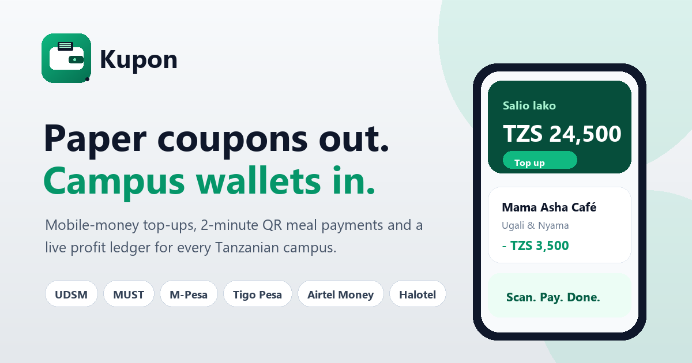

---

## Preview

Captured from the running app with real seeded data at 375px and desktop widths
(`pnpm screenshots` regenerates the whole set).

<table>
  <tr>
    <td width="50%">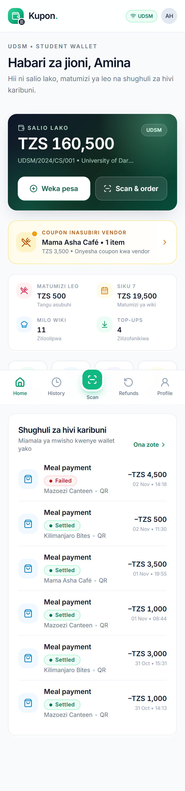</td>
    <td width="50%">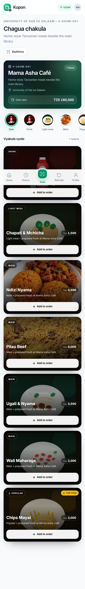</td>
  </tr>
  <tr>
    <td>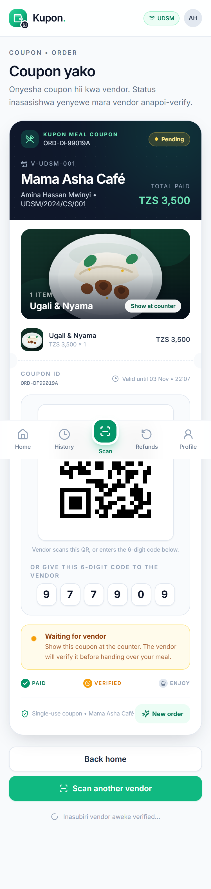</td>
    <td>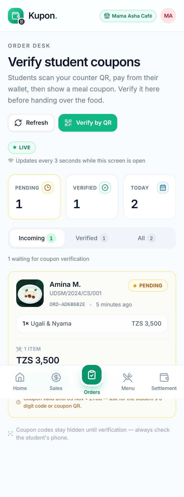</td>
  </tr>
  <tr>
    <td>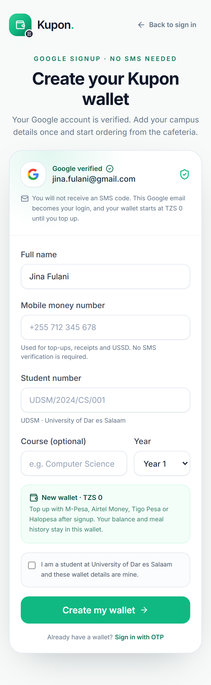</td>
    <td>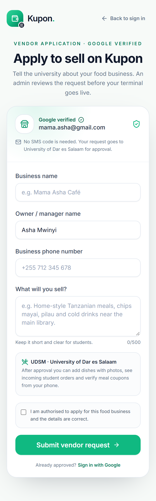</td>
  </tr>
  <tr>
    <td>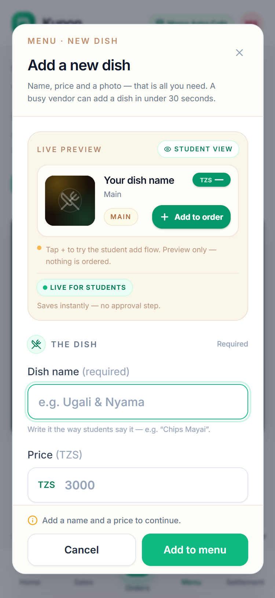</td>
    <td>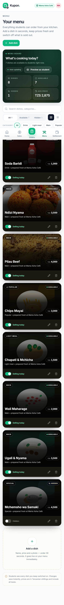</td>
  </tr>
</table>

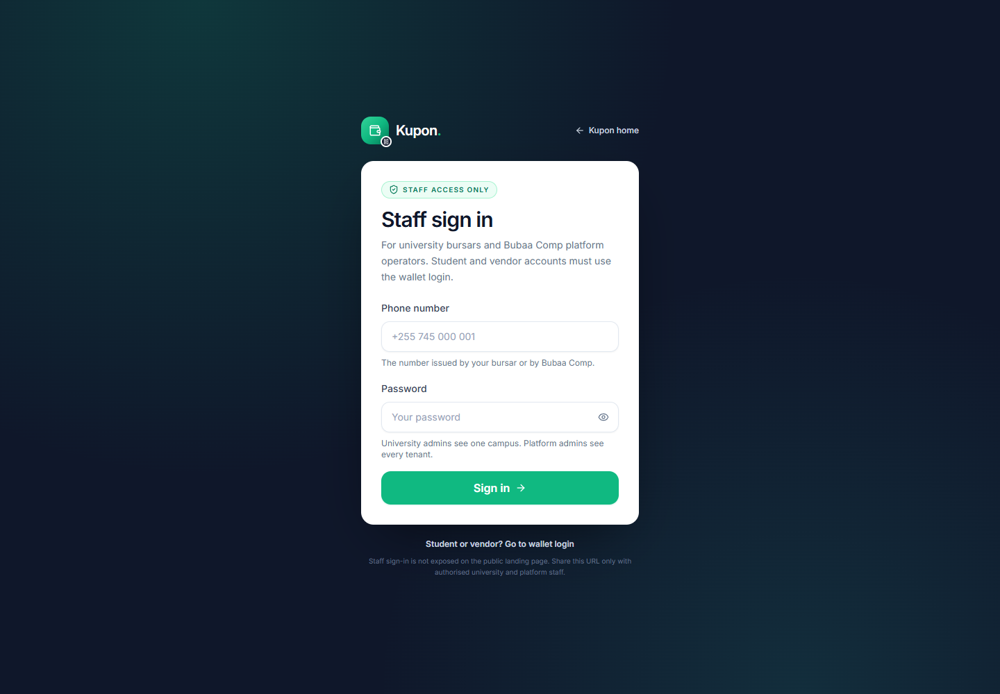

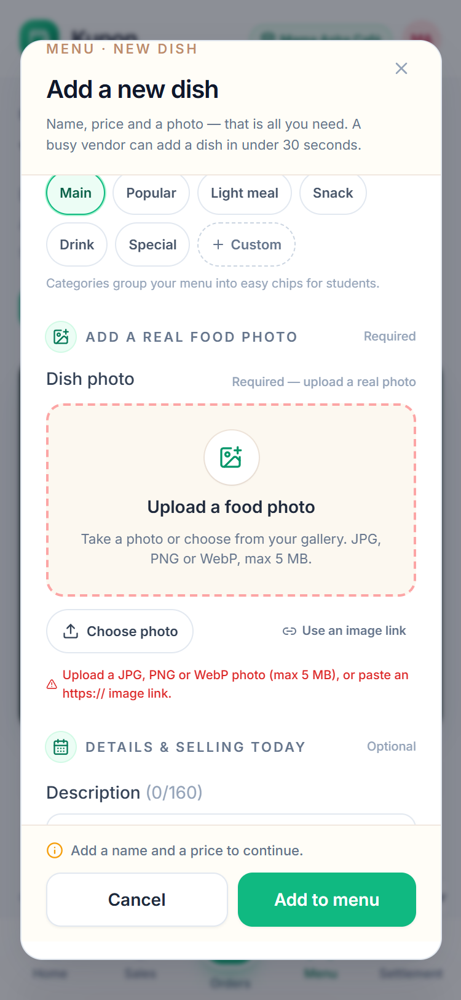

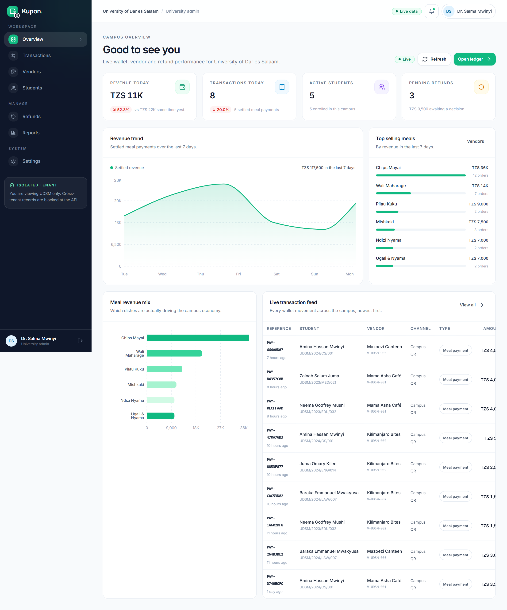

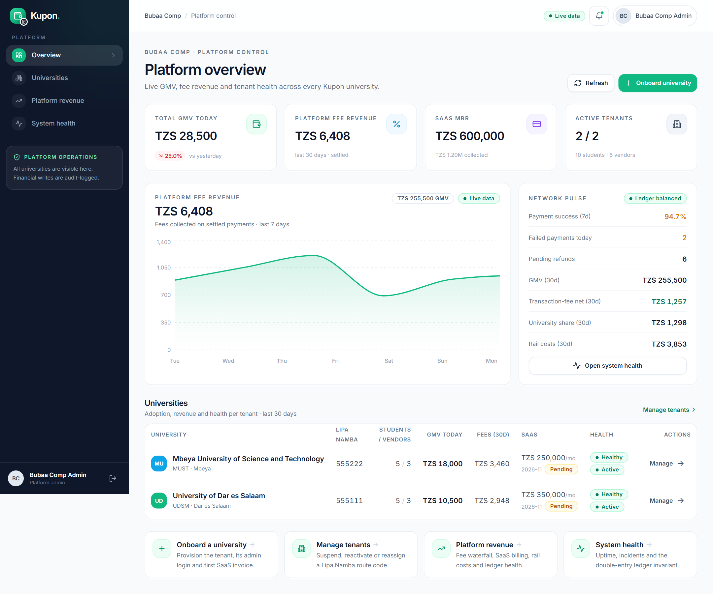

<table>
  <tr>
    <td width="50%">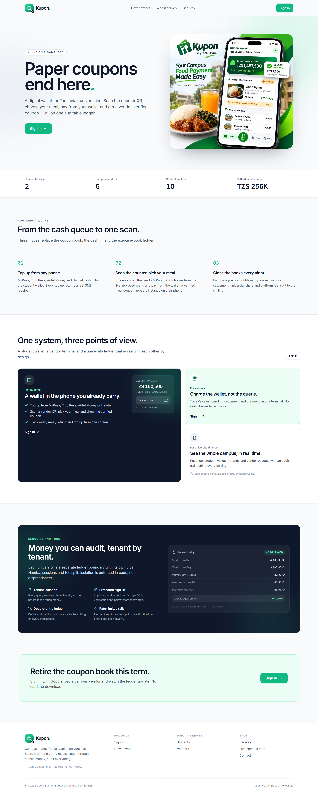</td>
    <td width="50%"></td>
  </tr>
</table>

---

## Why Kupon

| Problem today | Kupon |
| --- | --- |
| Printed coupon booklets get lost, stolen or forged | Single-use QR / 6-digit meal coupon tied to a paid order and verified by the vendor |
| Vendors keep paper ledgers and argue about totals | Every sale settles instantly into a vendor pending balance with a double-entry journal |
| Students lose leftover change and cannot see spending | Wallet balance, TZS top-ups, meal history and refunds in one place |
| University finance offices see numbers days later | Live dashboard: revenue, transactions, vendors, top meals, refunds, CSV/PDF export |
| One tenant's data could leak into another campus | Tenant ID is enforced in every API route, not only in the UI |
| Students need a smartphone browser | Installable PWA plus Google sign-in; offline USSD payments are intentionally paused in this build |

---

## Feature tour

### Student (mobile-first, installable PWA)

- **Google-first auth** for students and vendors. Students sign in or create a fresh wallet with Google; vendors sign in with Google or submit a business application for admin approval. The phone-OTP implementation is retained in the code but **temporarily disabled** (`OTP_LOGIN_ENABLED = false`) so it can be switched back on when SMS delivery is ready.
- Wallet home: **Salio**, top-up, scan-to-order CTA, pending-coupon banner, today's spend, meals this week, recent activity.
- Top up with **1,000 / 2,000 / 5,000 / 10,000 TZS** or a custom amount, choose network, mock STK push, polling and success state with new balance and Lipa Namba.
- **Student scans the vendor's counter QR** (or types the vendor code), browses the approved menu with food images, chooses meals with quantity steppers and pays from the wallet.
- A **live meal coupon** with food image, items, order ID, 6-digit code, QR and status appears after payment. It animates to **VERIFIED** when the vendor checks it, with polling, haptic feedback and a confetti/check animation.
- Transaction history with Today / Week / Month tabs, type/status filters and totals.
- Refund request with status tracking and admin notes.
- Profile, university, student ID, PWA install hint and logout.

### Vendor (mobile-first POS)

- Vendor Google sign-in, a Google-first application form, and university-admin approval before the terminal goes live. The legacy vendor code + PIN form is preserved behind a demo toggle.
- A printable, camera-friendly **counter QR** (`KPN:V:<vendor code>`) for students to scan. It opens the vendor's live approved menu and cannot move money on its own.
- **Live order desk:** incoming paid orders with food images, student identity, items, totals and coupon status; polling every 3 seconds, new-order toasts/haptics and animated cards.
- **Coupon verification:** scan the student's coupon QR or enter the 6-digit code shown on their phone. Single-use conditional status transition plus a celebratory verified screen; the student coupon updates live.
- Menu management with a live student preview, real photo uploads, prices, categories and availability. Vendors upload their own dish photos; there is no emoji fallback. Food is vendor-owned and goes live immediately; the university admin vets the vendor, not each dish.
- Today's sales, transaction count, top items, recent payments.
- Pending settlement, paid history and a mock instant payout request.
- Vendor never sees another vendor's or university's orders or sales.

### University admin (responsive dashboard)

- 4 live stat cards: revenue today, transactions, active students, pending refunds.
- 7-day revenue area chart with transaction counts and net profit.
- Top-selling meals with progress bars and a horizontal bar chart.
- Live transaction feed with status badges.
- Searchable/filterable transaction table, CSV download and print-to-PDF report.
- Vendor onboarding, suspension, per-vendor sales.
- Student search, wallet visibility, manual credit/debit with mandatory reason + audit log.
- Vendor vetting: add, view sales, suspend or reactivate a vendor. Admins do not approve individual dishes.
- Refund approve/reject with notes; approval triggers the mock payout.
- University profile, **Lipa Namba** routing code, SaaS billing invoices, ledger health, audit trail.
- Daily/weekly/monthly profit & loss, fee waterfall, revenue leakage and top vendors.

### Super admin (Bubaa Comp)

- All tenants, revenue today, monthly GMV, platform fee revenue, SaaS MRR.
- Onboard a university: code, route code, city, SaaS fee, first admin account.
- Suspend/reactivate tenants, edit Lipa Namba with uniqueness validation and audit.
- Platform revenue: GMV, transaction fees, university share, aggregator cost, SaaS revenue, net.
- System health: real success rate, failed transactions, ledger balance check, mock uptime/latency and service status.

### USSD — paused

USSD/offline payments are **not supported in this build**. The simulator page, API route and `chargeViaUssd()` implementation are retained behind `USSD_ENABLED=false` so they can be re-enabled later. `/ussd` renders the not-found page and `/api/ussd` returns `404 USSD_DISABLED` while the flag is off. No USSD link is rendered on the landing page, login page, footer or 404 page.

---

## Tech stack

| Layer | Choice |
| --- | --- |
| Framework | Next.js **14.2.35** App Router, TypeScript, React 18 |
| UI | Tailwind CSS, shadcn/ui-style primitives (Radix UI), Lucide icons, Sonner toasts |
| Charts | Recharts |
| State | Local React state + typed fetch client; session from httpOnly JWT cookie |
| QR | `qrcode.react` (generate), `html5-qrcode` (scan) |
| Auth | `jose` HS256 JWT in an httpOnly, SameSite=Lax cookie; bcrypt for staff credentials; Google OAuth 2.0 for student sign-in/signup and vendor sign-in/application |
| Validation | Zod on every mutation + query filter |
| Database | Prisma 6 + PostgreSQL (Supabase) |
| Payments | Provider interface + mock **Snippe** implementation (STK push, settlement, refund, smart routing) |
| SMS | Mock SMS logger; USSD code retained but disabled via feature flag |
| PWA | Web manifest, maskable icons, offline fallback, service worker (never caches API/HTML) |
| Deploy | Vercel-compatible Next app; use Postgres for persistent serverless data (see below) |

---

## Quick start

Prerequisites: **Node.js 20+**, **pnpm 9+** (npm also works but lockfile is pnpm).

```bash
# 1. Install
pnpm install

# 2. Configure
cp .env.example .env        # Windows PowerShell: copy .env.example .env

# 3. Apply the PostgreSQL schema
pnpm db:migrate:deploy

# 4. Run
pnpm dev
```

Open **http://localhost:3000**.

> Configure both `DATABASE_URL` (transaction pooler) and `DIRECT_URL` (session
> pooler) in `.env` before running Prisma commands. The example URLs use a
> placeholder password; URL-encode special characters in your real password.
> `pnpm db:seed` creates destructive demo data; run it only against a disposable
> development project, never the production database. If a StudentProfile ever
> exists without its Wallet row, run `pnpm db:repair`; student routes also self-heal wallets.


### just do this broo 
``` bash


pnpm dev

ngrok http 3000


```


### Verify the build

```bash
pnpm typecheck
pnpm lint
pnpm build
pnpm start
```

---

## Demo credentials

| Role | Credentials | Where it lands |
| --- | --- | --- |
| **New student (Google)** | Any verified Google account → **Continue with Google** | Creates a fresh TZS 0 wallet |
| Seeded student wallet | `amina.mwinyi@udsm.ac.tz` (after an admin links your real Google email) | Continue with Google |
| Seeded student wallet | `kelvin.mwakalinga@must.ac.tz` (after linking) | Continue with Google |
| **New vendor (Google)** | Vendor tab → Continue with Google → application | `/vendor-pending`, then `/vendor` after approval |
| **Vendor (UDSM) legacy** | `V-UDSM-001` · PIN `1234` via the demo terminal toggle | `/vendor` |
| Vendor (MUST) legacy | `V-MUST-001` · PIN `1234` via the demo terminal toggle | `/vendor` |
| **University admin (UDSM)** | `+255745000001` · `admin1234` | `/staff/login` → `/admin` |
| University admin (MUST) | `+255745000002` · `admin1234` | `/staff/login` → `/admin` |
| **Super admin (Bubaa Comp)** | `+255745000000` · `super1234` | `/staff/login` → `/super-admin` |
| USSD (paused) | `USSD_ENABLED=false` | `/ussd` not found; API returns 404 |

**Staff do not use the public landing login.** The public `/login` page exposes only Student and Vendor tabs. University and platform staff enter through `/staff/login`; old `/login?role=staff` bookmarks redirect there. The staff page is `noindex`, not linked from the landing page, and staff sign-out returns to `/staff/login`.

All other seeded students: UDSM `+255713456789`, `+255714567890`, `+255715678901`, `+255716789012`; MUST `+255718901234`, `+255719012345`, `+255720123456`, `+255721234567`. OTP endpoints still work for tests/back-office tooling, but the login UI no longer shows them.

### Google auth: students and vendors

Phone OTP is temporarily disabled in the UI (`OTP_LOGIN_ENABLED = false` in `app/login/login-form.tsx`). The complete OTP code and API endpoints are kept intact for when SMS delivery is enabled.

**Student — Continue with Google** handles both paths:

1. **Existing wallet** — the Google email is already linked (`User.email` / `googleId`), so the callback signs the student straight into that wallet.
2. **New student** — a verified Google email with no wallet is redirected to `/signup/google`. The student confirms their name, mobile-money number, student number, course and year. Kupon creates a **fresh wallet with TZS 0**, signs them in, and writes an audit entry. No SMS OTP is involved and no admin approval is needed.
3. **Existing wallet with an unlinked Google account** — the callback deliberately does **not** attach the Google account automatically, because that would let someone claim a funded wallet by guessing an email. An admin links it from **Students → Google sign-in fallback**, or the CLI links it.

Security model:

1. Google OAuth authorization-code flow with a random signed `state` cookie (10-minute TTL) and server-side token exchange.
2. Google's `email_verified` claim is required.
3. The OAuth callback never creates a wallet by itself. It issues a **signed, HttpOnly, 15-minute signup ticket**; the signup POST must present that ticket, so a browser cannot create accounts without Google consent.
4. The signup route re-checks university status, unique Google email/sub, unique phone and unique student number inside one transaction, then writes `User`, `StudentProfile`, `Wallet` and the audit log atomically.
5. The same httpOnly Kupon session cookie is issued after signup or sign-in; the client secret never reaches the browser.

> Open Gmail signup is intentionally enabled for this MVP. For a production campus rollout, restrict signup to the university's Google Workspace domain (or match student numbers against the registry) so personal Gmail accounts cannot create university wallets.

**Vendor — Continue with Google**

1. Vendor tab → select campus → **Continue with Google**.
2. If that Google account is already an approved vendor, it goes straight to the order desk.
3. If the Google account is brand new, `/vendor-apply` asks for business name, owner name, business phone and what the vendor sells.
4. Submitting creates a **PENDING vendor** and a vendor session, then redirects to `/vendor-pending`.
5. The university admin sees the pending request in **Admin → Vendors**, filters **Pending**, and clicks **Approve**. The vendor can then refresh `/vendor-pending` and enters `/vendor`.
6. Rejected/pending vendors cannot call any vendor API (`requireVendor` blocks non-ACTIVE status); the pending page is the only authenticated screen they can open.

The legacy vendor code + 4-digit PIN form is preserved behind **“Use an existing terminal code (demo)”** on the Vendor tab so the seeded vendors remain usable.

Configure it in `.env` (see `.env.example`):

```env
GOOGLE_CLIENT_ID="..."
GOOGLE_CLIENT_SECRET="..."
GOOGLE_REDIRECT_URI="http://localhost:3000/api/auth/callback/google"
```

Add the exact redirect URI to **Google Cloud Console → APIs & Services → Credentials → OAuth 2.0 Web Client**. For production, set `GOOGLE_REDIRECT_URI` to the deployed URL and add that exact URI in Google Cloud Console.

Link a real Google email to an existing demo wallet, either from the admin UI or the CLI:

1. **Admin UI:** sign in as university admin → **Students** → open the student → **Overview** → **Google sign-in fallback** → enter the student's Google email → **Link email**. Audit-logged.
2. **CLI:**
   ```bash
   pnpm link:google +255712345678 your.email@gmail.com
   ```

Then sign out and choose **Continue with Google**. The seed already includes university emails for every student (`amina.mwinyi@udsm.ac.tz`, `kelvin.mwakalinga@must.ac.tz`, etc.), but those are illustrative; link the student's real Google address first.

**Google OAuth troubleshooting**

- **Use `http://localhost:3000`, not `http://127.0.0.1:3000`.** The Google Cloud client is configured for localhost. The start route detects a 127.0.0.1 host and canonicalizes it, but the cleanest demo URL is localhost.
- **`ERR_CONNECTION_REFUSED` after Google:** the Kupon server was not running, or was on a different port/host when Google redirected back. Start it with `pnpm start` (or `pnpm dev`) and keep the same origin open. Check `http://localhost:3000` first.
- **`redirect_uri_mismatch`:** add exactly `http://localhost:3000/api/auth/callback/google` (and the production equivalent) under Google Cloud Console → APIs & Services → Credentials → your OAuth 2.0 Web Client → Authorised redirect URIs. Set `GOOGLE_REDIRECT_URI` to the same value.
- **`Access blocked` / app not verified:** while the OAuth consent screen is in Testing, add your Google account as a test user in Google Cloud Console, or publish the app.
- **Google auth on the hosted app:** open the stable Vercel domain from your phone. Set `GOOGLE_REDIRECT_URI` to `https://<your-domain>/api/auth/callback/google` in Vercel and add that exact URI to the OAuth client’s authorized redirect URIs in Google Cloud Console. A local tunnel is not needed for the hosted app.
- **Existing wallet not linked to Google:** the callback does not attach Google to a funded wallet automatically. Link it from **Admin → Students → student → Google sign-in fallback**, or run `pnpm link:google <phone> <email>`. New students do not need this step — they get the signup form.
- **`google_signup_expired`:** the 15-minute signup ticket expired. Start **Continue with Google** again.
- **`google_vendor_expired`:** the 15-minute vendor application ticket expired. Start again from the Vendor tab.
- **`google_vendor_missing`:** that Google account has no vendor record yet — submit a vendor application from the Vendor tab.
- **Phone or student number already registered:** ask an admin to link the Google email to the existing wallet. The signup route never merges two wallets.

---

## Five-minute demo script

1. **Student:** open `/login` → Student tab → pick UDSM → **Continue with Google**. A new Google account creates a fresh TZS 0 wallet. To use the seeded Amina wallet and its pending coupon, first sign in as admin at `/staff/login` → Students → Amina → **Google sign-in fallback** → link your Gmail, then sign in with Google. OTP is temporarily disabled.
2. **Scan / order:** open **Scan**, tap **New order** on the coupon, then **Open camera** (or use the demo vendor chip for *Mama Asha Café* in headless demo environments). Browse the photo menu, add *Ugali & Nyama* and *Soda*, review the cart, and pay from the wallet.
3. **Coupon:** the phone animates in a meal coupon with the food image, order ID, 6-digit code, QR and **Waiting for vendor** status. It polls every 3 seconds.
4. **Vendor application:** in a second browser window, open `/login` → Vendor tab → pick UDSM → **Continue with Google** → submit the application. You land on `/vendor-pending`. In the admin window (`/staff/login`), open **Vendors → Pending** and click **Approve**.
5. **Vendor:** back in the vendor window, refresh `/vendor-pending` → you land on the order desk. The new order appears (toast + animation). Tap **Enter code**, type the 6 digits from the student coupon, and verify. The vendor sees the celebratory verified screen. (Demo shortcut: **Use an existing terminal code** → `V-UDSM-001` / `1234`.)
6. **Student:** within ~3 seconds the coupon animates to **Verified**, with the check/confetti and haptic feedback. Show it at the counter to collect the meal.
7. **Admin:** sign in at `/staff/login` as UDSM admin. Dashboard revenue and the live feed update. Open **Refunds**, approve a pending request with a note; the student wallet is debited and the refund transaction appears. Try **Students → manual credit** and check the audit log in Settings.
8. **Tenant isolation:** sign in at `/staff/login` as MUST admin (`+255745000002`). You will not find UDSM students, vendors or transactions anywhere; direct API attempts for another tenant return `403`.
9. **Super admin:** see both tenants, per-tenant revenue, SaaS invoices and the ledger health check.


---

## Money flow & fee waterfall

Every campus payment is settled inside one PostgreSQL transaction:

```
Student wallet (debit 100%)
├─ Vendor pending settlement   97.5%
└─ Platform fee                 2.5%
   ├─ University revenue        0.5%   (20% of the platform fee)
   ├─ Aggregator rail cost      1.5%
   └─ Kupon net revenue         0.5%
```

- Current fee constants live in `.env` (`PLATFORM_FEE_PERCENT`, `AGGREGATOR_FEE_PERCENT`, `UNIVERSITY_REVENUE_SHARE_PERCENT`).
- Every wallet, payment, top-up, refund and manual-adjustment movement writes a **balanced double-entry journal** in `LedgerEntry`. Debits must equal credits; `postJournal()` throws and rolls the whole Prisma transaction back otherwise. Vendor bank payouts move the vendor's `pendingBalance` to `totalSettled` and are recorded in `Settlement` (a treasury movement outside the student-facing journal).
- Top-up: debit `CASH_TRUST`, credit `STUDENT_WALLET`.
- Payment: debit `STUDENT_WALLET`; credit `VENDOR_PENDING`, `UNIVERSITY_REVENUE`, `AGGREGATOR_PAYABLE`, `PLATFORM_REVENUE`.
- Refund: debit `STUDENT_WALLET`, credit `CASH_TRUST`.
- Admin manual adjustment: wallet + `CASH_TRUST` + an immutable `AuditLog` row.
- Wallet debits are **conditional** (`UPDATE ... WHERE balance >= amount`), so two simultaneous QR scans can never overdraw a wallet.

Smart routing: each transaction stores `routeCode = university.paymentRouteCode` (the Lipa Namba) in both `Transaction.routeCode` and metadata. `chargeWithToken()` verifies student, vendor and token all belong to the same university before any money moves.

---

## Project structure

```text
app/
  page.tsx                    Marketing landing (supplied brand hero image)
  login/                      Google-first student/vendor auth + staff password (OTP code retained, disabled)
  student/                    Wallet, top up, QR pay, history, refunds, profile
  vendor/                     POS home, scan & charge, sales, menu, settlement
  admin/                      Dashboard, transactions, vendors, students, refunds, menu, reports, settings
  super-admin/                Tenants, platform revenue, health
  ussd/                       Feature-phone simulator (paused via feature flag)
  api/                        Route handlers with RBAC + Zod
    auth/ student/ vendor/ admin/ super-admin/ ussd/ universities/
components/
  ui/                         shadcn-style Button, Card, Table, Badge, Dialog, Tabs, Input, Skeleton...
  layout/                     StudentShell, VendorShell, DashboardShell, service worker
  charts/                     Recharts area, bar and volume charts
  qr/                         PaymentQR, QrScanner
lib/
  auth.ts                     JWT session, page/API guards, tenant assertion
  api.ts / errors.ts          Response envelope + typed errors
  db.ts                       Prisma singleton
  payments/                   PaymentProvider interface, mock Snippe, charge service
  ledger.ts / wallet.ts       Double-entry journal + conditional wallet operations
  qr.ts                       Signed 120s QR token + 6-digit fallback
  tenant.ts                   Admin tenant scoping
  validators/                 Zod schemas
  fees.ts / dates.ts / utils.ts
prisma/
  schema.prisma               Multi-tenant schema
  seed.ts                     2 universities, 10 students, 6 vendors, 40 menu items, 160+ transactions
docs/API_CONTRACTS.md         Route-by-route contract used by the team
scripts/                      Seed verification, smoke tests, screenshots
```

---

## Data architecture: database-backed UI

No marketing metric, wallet balance, demo account, transaction, coupon, ledger line or vendor list is hardcoded in the UI.
- `lib/public-data.ts` is the public read model for the landing page: active universities/vendors/students, settled volume, wallet float, meals today, the latest coupon, recent wallet transactions and a real double-entry journal.
- The login page reads its campus snapshot from Prisma (students/vendors/dishes) and the staff page has no seeded credentials; credentials live in this README only.
- The student scanner fetches active vendors from the database via `GET /api/student/vendors`; there is no `DEMO_VENDORS` array.
- The landing hero uses the supplied Kupon brand artwork at `public/marketing/kupon-campus-food-wallet.webp`; the live metrics, ledger card and role cards around it are database reads. Remove or replace that asset if you want a different hero visual.
- Food photos are vendor-uploaded files (`POST /api/vendor/menu/upload`) and stored on `MenuItem.imageUrl`; emoji are ignored in the interface. Uploaded files are served by `GET /api/uploads/food/<filename>` because Next.js production does not serve files added to `public/` after the build. In production, point the upload route at S3/R2/Cloudinary instead.

## Authentication architecture

Kupon separates **customer auth** from **staff auth** at the route level, not just with a hidden tab:

| Audience | Entrance | Notes |
| --- | --- | --- |
| Students | `/login` (Student) | Google sign-in/signup; OTP UI disabled behind a flag |
| Vendors | `/login` (Vendor) | Google sign-in/application; legacy PIN demo toggle |
| University bursars | `/staff/login` | Password; `noindex`; not linked from the landing page |
| Platform operators | `/staff/login` | Same staff entrance; RBAC lands them on `/super-admin` |

- `/login` renders only Student and Vendor tabs. There is no Staff tab, staff demo card or staff link on the public landing page.
- `/login?role=staff` redirects to `/staff/login` for old bookmarks.
- `/admin` and `/super-admin` layouts redirect unauthenticated users to `/staff/login`, not `/login`.
- Staff sign-out and the dashboard sign-out button return to `/staff/login`.
- `/staff/login` is `noindex`, disallowed in `robots.ts`, and signs an existing student/vendor session out of the way by redirecting it to its own home.
- The staff API (`/api/auth/staff-login`) is unchanged; only the entrance and navigation architecture changed.

## Security model

- **RBAC on every API route:** `requireApiUser(['STUDENT'])`, `['VENDOR']`, `['ADMIN','SUPER_ADMIN']`, `['SUPER_ADMIN']`.
- **Google OAuth fallback:** state-cookie-protected authorization-code flow; server-side code exchange; `email_verified` required. Existing wallets sign in only when the Google email is pre-linked. New students receive a signed 15-minute signup ticket and create a separate zero-balance wallet with a unique phone/student number; Google never attaches itself to a funded wallet.
- **Meal coupons:** camera-friendly short QR (`KPN:C:<6-digit code>`) plus the visible 6-digit fallback. Vendor verification requires the coupon to belong to the signed-in vendor and university; a conditional `PENDING → VERIFIED` update prevents double redemption. Legacy signed coupon JWTs are still accepted.
- **QR production settings:** payloads are short pointers (`KPN:V:<vendor code>`) rather than JWTs; 224 px (196 px compact), error correction Q, 4-module quiet zone, black on white. This avoids the 60–77 module QR grids that phone cameras could not resolve.
- **Tenant isolation:** admin queries use `resolveTenantScope()`; students/vendors are derived from the session, never from a client-supplied ID. `assertTenant()` blocks cross-university reads/writes.
- **Session rehydration:** the JWT is verified, then the user is reloaded from the DB so suspended vendors/universities lose access immediately. Suspended university kills every tenant role.
- **Single-use payment tokens:** signed JWT (`jti`) + DB row + 6-digit unique code; server validates signature, expiry, tenant and `usedAt` inside a conditional update.
- **Zod validation** on every body/query mutation; stable `{ok,error}` envelope with human messages and no stack traces.
- **Rate limiting** (in-memory mock): OTP request/verify, vendor/staff login, top-up, token creation and charge. **Swap for Upstash Redis/KV in production** — the helper is `lib/rate-limit.ts`.
- **Audit log** for manual wallet adjustments, refund decisions, vendor onboarding/suspension, coupon verification, tenant onboarding and route-code changes.
- **Double-entry ledger invariant** checked when writing and exposed in Settings / Super-admin health.
- Security headers (`X-Frame-Options`, `nosniff`, Referrer-Policy, camera-only Permissions-Policy).
- The service worker **never caches HTML or `/api/*`**, so a shared campus phone cannot show another user's cached balance.

### Intentional MVP shortcuts (replace before production)

- OTP login is disabled in the UI for now; the code and APIs are retained for when SMS delivery is enabled. OTP codes are stored in plaintext (with 5-minute expiry, attempt limit and rate limit) and are returned by the API in `DEMO_MODE=true`.
- SMS is logged to the server console, not delivered.
- Google signup is open to any verified Google email in this MVP. In production, restrict it to the university's Google Workspace domain or verify the student number against the registry. Existing wallet linking is admin-controlled (or CLI) by design; there is no self-service claim of a funded wallet.
- Session JWT is stateless; no refresh-token rotation or device revocation list.
- Rate limiting is per-instance memory.
- The mock cash-in has **no collection fee**; a real aggregator will charge roughly 1.5% on top-ups, so decide whether to absorb it or pass a convenience fee to the student. Payment-level aggregator costs are fully modelled.
- Vendor applications have a PENDING state and admin approval, but there is no formal rejection workflow yet — an admin can suspend/reject by leaving the vendor pending or suspending it. Add a dedicated rejection reason before a real pilot.
- Vendor food photos are written to `public/uploads/food` and served through `/api/uploads/food/<filename>` on the local filesystem. Serverless hosts need object storage (S3/R2/Cloudinary) for durable uploads; the menu contract only stores the returned URL.
- Phone photos are resized in the browser to a maximum 1600px JPEG before upload, so large Android photos and most mobile gallery formats work without hitting the 5 MB limit.
- Vendor settlements are mock instant payouts recorded in `Settlement`; no bank/aggregator payout API is called.

---

## Replace the mock payment aggregator

The whole app talks to one interface in `lib/payments/types.ts`:

```ts
export interface PaymentProvider {
  readonly name: string;
  initiateTopUp(input: TopUpRequest): Promise<TopUpResult>;
  settlePayment(transactionId: string): Promise<{ transactionId: string; status: string; balance?: number }>;
  initiateRefund(input: RefundRequest): Promise<RefundResult>;
}
```

The current provider is `lib/payments/snippe.ts`. To connect **Selcom / AzamPay / N-Card / M-Pesa**:

1. Implement a class with the same three methods. In `initiateTopUp`:
   - Resolve the university's `paymentRouteCode` (Lipa Namba).
   - Call the aggregator's collection/STK-push API with the payer MSISDN.
   - Create the `Transaction` row with `status: 'PENDING'`, `routeCode`, and the aggregator reference in metadata.
   - Return the pending reference. **Do not credit the wallet yet.**
2. Add a verified webhook at `app/api/webhooks/payments/route.ts`:
   - Verify the aggregator signature/timestamp.
   - Find the transaction by provider reference.
   - Call `provider.settleTopUp(transaction.id)` (or `settlePayment`) only after verification.
   - Return `200` quickly and make settlement idempotent (`updateMany WHERE status='PENDING'` already does this).
3. Implement `initiateRefund` with the aggregator payout API and keep the wallet debit atomic; only mark the refund final after payout confirmation.
4. Register the class in `lib/payments/index.ts` and set:
   ```env
   PAYMENT_PROVIDER=selcom   # or azampay, ncard
   ```
5. Replace the mock SMS in `lib/sms.ts` with Beem Africa, NextSMS or Africa's Talking.
6. Replace the in-memory limiter with Upstash Redis and add a real OTP provider (or keep SMS OTP).
7. Keep `routeCode` attached to every transaction — this is what decides which university account receives the money.

The mock's comments mark each line that must change. No route handler or UI component imports Snippe directly; they all use `getPaymentProvider()`.

---

## Deployment

### Vercel

The app is a standard Next.js 14 project and deploys without a custom server:

```bash
vercel
```

Connect the GitHub repository to Vercel and set the variables from `.env.example`
in the Production environment. Use the Supabase transaction-pooler URL for
`DATABASE_URL`, the session-pooler URL for `DIRECT_URL`, and set
`NEXT_PUBLIC_APP_URL` and `GOOGLE_REDIRECT_URI` to the deployed HTTPS domain.
Register the exact Google callback (`https://<your-domain>/api/auth/callback/google`)
in Google Cloud Console. Run `pnpm db:migrate:deploy` against the Supabase project
before the first deployment; the checked-in migrations create the schema.

Use a separate Supabase project for Vercel Preview deployments so preview builds
cannot apply migrations to production. Set a strong `JWT_SECRET` and
`DEMO_MODE=false` in Vercel. Do not copy secrets into GitHub.

> Vendor-uploaded food photos are stored in PostgreSQL so they persist across
> serverless deployments. For larger media libraries, move binary files to
> object storage to reduce database storage and bandwidth. Also replace the
> in-memory rate limiter with a shared store before scaling to multiple
> serverless instances.

### Docker / VPS

`pnpm build && pnpm start` behind Nginx can connect to the same managed PostgreSQL database. Configure both database URLs and run `pnpm db:migrate:deploy` before starting the app.

---

## Testing checklist

```bash
pnpm typecheck                  # strict TypeScript
pnpm lint                       # next/core-web-vitals
pnpm build                      # production build
pnpm db:reset                   # deterministic seed + ledger check

# With the app running on :3000 and a freshly seeded DB:
pnpm smoke                      # 48-assertion end-to-end API + ledger test
pnpm audit:mobile               # every route at 375px: horizontal-overflow audit
pnpm screenshots                # 19 mobile + desktop screenshots
pnpm screenshots:flow           # food/menu, vendor apply, Google signup and staff login states
```

The repository also includes:

- `scripts/smoke-test.mjs` — logs in as every role and exercises the critical API paths (Google OAuth start, tenant isolation, wallet, vendor menu QR, order placement, coupon verification/replay, disabled-USSD guard, dashboard, health and the double-entry ledger). It mutates the demo wallet; run `pnpm db:reset` afterwards.
- `scripts/audit-mobile.mjs` — opens every authenticated route at 375px and fails loudly if `scrollWidth > clientWidth`.
- `scripts/screenshots.mjs` — captures the main 20-screenshot set in `screenshots/`.
- `scripts/screenshots-flow.mjs` — captures the interactive design states (student food menu/cart, vendor add-dish dialog, student preview, Google signup, vendor application and the staff entrance).

Manual checks worth doing before a real pilot:

- Two concurrent scans with the same QR: second must fail with “already used”.
- Student worth TZS 1,000 trying to pay TZS 3,500: API returns `402 INSUFFICIENT_FUNDS`; no journal row.
- UDSM admin requesting a MUST student ID: `403`.
- Approve a refund twice: second request cannot revert an approved request.
- Kill the dev server during a mock top-up: after restart, the wallet endpoint lazily settles the stale top-up (the mock sweep) exactly once.

---

## Roadmap beyond the MVP

- Real aggregator webhooks + reconciliation job.
- PostgreSQL + row-level security / Prisma tenant extension.
- OTP delivery via Beem/NextSMS and IP + device fingerprint rate limits.
- Offline-first vendor queue for flaky campus Wi-Fi (IndexedDB + idempotency keys).
- Vendor payout batching (T+1) and bank reconciliation.
- Student meal plans / daily limits / parental top-ups.
- Swahili-first localization with next-intl.
- Receipt PDFs and WhatsApp notifications.
- SOC2-style audit export and per-tenant data retention controls.

---

Built for the Tanzanian campus. **Kupon — salio lako, chakula chako, kwa mkupuo mmoja.**

© 2026 Bubaa Comp. MVP reference implementation.
